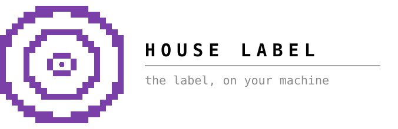

<div align="center">


**v0.1 · beta** · Quebec validated · Bun ≥ 1.1 · runs on your Claude subscription or your own key

</div>

> **Beta.** The `houselabel` command and the setup are still changing. The agents and skills are the solid part: open the repo folder in Claude Code or Claude Desktop and talk to them directly.

## About

House Label is the first agentic music label: a record label made of agents,
for independent artists and small teams putting out a single, an EP or an
album. Each department knows its job — press, promotion, distribution, grants,
rights — and helps you manage your music career and plan a release.

## How to use

Two ways: **Standard** or **Dev mode**.

### Standard

For Claude Desktop. No terminal knowledge needed.

1. Install [Docker Desktop](https://www.docker.com/products/docker-desktop/) like any app, and open it once. It keeps your label's memory on your computer.
2. Download the repository: <https://github.com/chloepilonv/house-label> → **Code → Download ZIP**, and unzip it in `Downloads/`.
3. In Claude Desktop, open the `house-label` folder and paste:

   > Look at `Downloads/house-label`. Set up the label for me, then use the label manager to create my artist profile and plan my first release campaign. The skills are in `.claude/skills/`, each department in `agents/<department>/`. If Bun is missing, install it. Keep in mind: I might be a non-tech user.

4. A panel opens on the right with a few questions. Pick **My Claude subscription** (no key needed), keep the default database, then answer your profile.
5. **Recommended: connect Google** (~8 min, once). Ask Claude *"connect my Google Drive"* and follow the steps. Your release folders, Plan sheet and calendar then live in your own Drive. Without it, the label still works: your plan opens as a page in your browser.

### Dev mode

In a terminal or an IDE. Needs [Bun](https://bun.sh) ≥ 1.1 and [Docker](https://docs.docker.com/desktop/) open.

1. Clone the repo:

   ```bash
   git clone https://github.com/chloepilonv/house-label.git && cd house-label
   ```

2. Set up everything — provider, database, profile, connections (~10 min, safe to re-run):

   ```bash
   ./setup-label.sh
   ```

3. Then either point your coding agent (Claude Code, Codex, Cursor…) at the repo with the prompt from **Standard**, or talk to each department directly, on your subscription or your own API key:

   ```bash
   houselabel                    # your label manager
   houselabel press              # any department by name · --staff lists them
   houselabel profile            # change your answers
   houselabel recap              # what got done, what is due, how the numbers moved
   houselabel recap --schedule   # the same, emailed to you every Monday at 08:00
   houselabel example            # example campaigns, built in your Drive by the label's template
   bun run presskit:print        # your presskit as a PDF, in your language
   ```

## Connectors

Connect **Google** — Drive, Gmail, Calendar. It is what the label is built on.

```bash
houselabel connect google     # prints the ~8 min OAuth setup
houselabel connect hunter     # optional: the journalist behind info@, with your own key
houselabel connect --status
houselabel voice learn --gmail   # optional, 5 min: reads your sent mail so every draft sounds like you
```

## Current services

| Agent | Does | Skills |
|---|---|---|
| **Label manager** `houselabel` | Scopes the release, dates every step, names who owns it, builds your Drive folders and Calendar, emails you every Monday | scope-project · plan-release · check-readiness · brief-department · build-credits · learn-voice · weekly-recap |
| **Distribution** | Picks a distributor from 39, prepares the upload checklist | compare-services · prepare-package |
| **Digital marketing** | Dated campaign plan, content ideas and captions, your website | plan · draft-content · build-website |
| **Press** | Media contacts (QC, CA, US), the pitch, outreach tracking | draft-pitch · compose-outreach · manage-contacts · run-campaign |
| **Promotion** | Radio stations and playlists worth pitching, and the pitch | match-radio · match-playlists · draft-pitch |
| **Presskit** | Interview that asks only the gaps → printed A4 presskit in your language (or both), in your Drive | build · print |
| **Rights** | Which societies to join (SOCAN, ASCAP…), song catalog, splits, ISRCs | register-orgs · manage-catalog |
| **Platforms** | Logs the numbers you read on your dashboards, explains them | log-numbers · explain-metric · read-trend |

All 🧪 beta — used on one real release in 2026.

**To do** — built, not yet used end to end:

| Agent | Does | Skills |
|---|---|---|
| **Grants** | CA/US funding you qualify for, application drafts | find-programs · draft-application · remember |
| **Accounting** | Expenses and receipts in one Budget sheet. **Not an accountant: no tax advice** | log-expense · read-receipt |
| **Booking** | Venues ranked by fit, the inquiry, the tour, the setlist declaration | match-venues · draft-outreach · plan-tour · declare-setlist |

Full roster, statuses and the format contract: [agents/README.md](./agents/README.md).


## Next steps

- **Regions.** Validate the tool for the rest of Canada and US. 
- **Agents.** Create and validate Grants, Accounting, Booking, Merch agents and more.
- **Google in one click.** A shared House Label app so connecting Drive is a "Sign in with Google" button, not an 8-minute setup.
- **Front-end.** Create a web version that any non-tech users can easily use (think of Hubspot or similar web apps)

## See an example

Marie-Gold used House Label for her single « banale baddie » (October 2026).
Build her campaign in your Drive with the label's own template — the Plan
sheet, the budget, the useful links, the lyrics, the credits and the media:

```bash
houselabel example marie-gold
```

## Acknowledgements

The knowledge in these agents was not invented here. People from the Quebec
music community gave their time so the departments say true things:

- **Bertrand Menon** — *L'autoproduction : guide pratique et juridique* (APCM,
  2025), the backbone of the rights department.
- **Sébastien Charest**, **Julie Desjardins** (COOP Faux-Monnayeurs) and
  **the Métamusique team**, for their advice.
- **Laurent** and the artists who let a department run their release and told
  us where it was wrong.

## License

© 2026 Chloe Bibiane Pilon Vaillancourt · [GNU AGPL-3.0](./LICENSE). Free to use, change and share. If you run a modified
version for others, including as a website or paid service, you must publish
your changes under the same license.

Contributors: [CONTRIBUTING.md](./CONTRIBUTING.md) · [doc/DEVELOPMENT.md](./doc/DEVELOPMENT.md) · [AGENTS.md](./AGENTS.md) · [doc/ARCHITECTURE.md](./doc/ARCHITECTURE.md)
