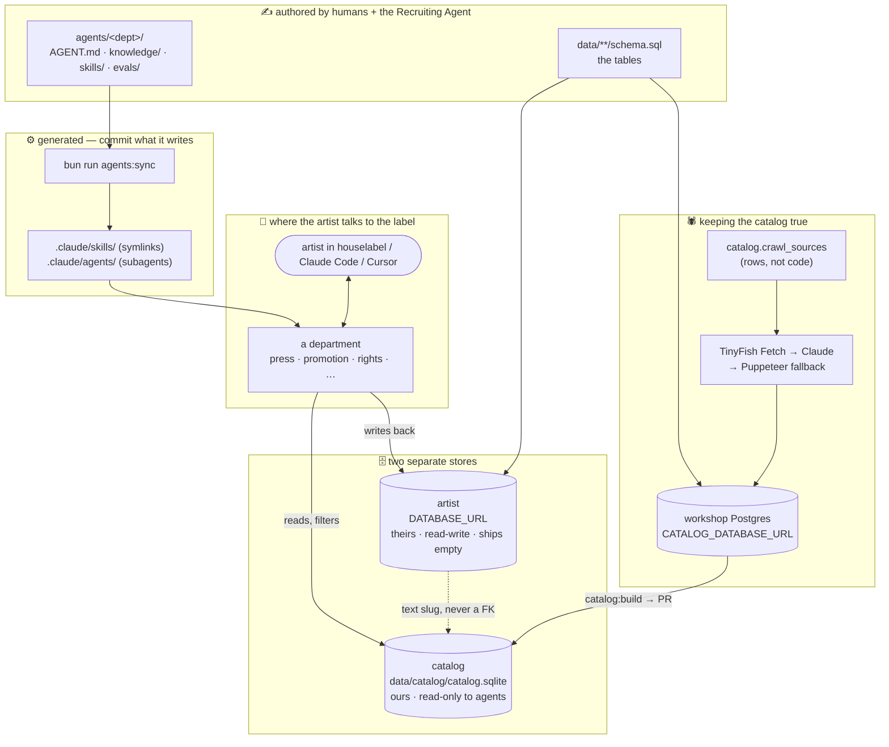
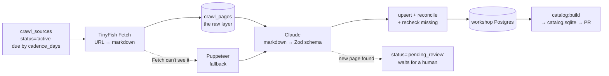

# How this repo works

**In one sentence:** Markdown departments (`agents/`) answer an artist's
questions by filtering a crawled reference file (`data/catalog/catalog.sqlite`),
and write what they learn into the artist's own database (`data/artist/`).

Commands live in [DEVELOPMENT.md](./DEVELOPMENT.md); the agent format in
[agents/README.md](../agents/README.md); both stores in
[data/README.md](../data/README.md).

---

## 1. The map



## 2. Staff — `agents/`

Each folder under `agents/` is one department. The roster and statuses are the
table in the root [README](../README.md#departments).

```
<department>/
├── AGENT.md                 identity + frontmatter (doubles as a subagent def)
├── knowledge/<topic>.md     what it KNOWS — prose an agent reads
├── skills/<slug>-<verb>/    what it can DO — one folder per skill
│   └── SKILL.md             Input · Process · Output · Guidelines
└── evals/evals.json         how we know it works
```

Three rules:

1. **A skill is a folder**, never a loose `.md` — the
   [Agent Skills spec](https://agentskills.io/specification), and the only shape
   that can carry `scripts/`.
2. **Skill names are globally unique**: `<slug>-<verb>` → `promotion-match-radio`.
   Everything lands in one flat namespace after sync.
3. **Filter or read?** If an agent *filters* it → a table in `data/catalog/`.
   If it *reads* it → `knowledge/*.md`.

**How a skill reaches your tools.** Neither Claude Code nor Cursor scans
`agents/`. `bun run agents:sync` writes the symlinks in `.claude/skills/` and
the subagent files in `.claude/agents/` that they do scan. `agents:check` (the
CI gate in `.github/workflows/agents.yml`) fails on any drift from the contract.

**The greeting.** Every department opens with one paragraph generated from the
`greeting:` line of each `SKILL.md` and the `discuss:` line of `AGENT.md`, so a
skill cannot be missing from it. `engine/greeting.ts` reads the artist's reply
once with a small model: a task request starts that task (`mode: task`);
anything else is a conversation grounded in `knowledge/`.

**The interview is code, not a prompt.** Keeping the question list in a prompt
leaves the chat transcript as the only state — so a typed budget survives only
as the sentence "about 500 bucks". Here the state lives in code:

```
engine/interview/core.ts   step(flow, state, input?) → Step   PURE: no fs, no db
        │
   engine/session.ts        advances the flow BEFORE the model is called,
                            then asks the model to say that one question warmly
```

Each task's questions are a `FLOW` in its `scripts/questions.ts`. The core
cannot skip a question, ask twice, or let an offer from the artist's file
overwrite an answer they gave. Because it touches nothing, a web front end can
call the same core later.

**The model's tools are data only** ([`engine/tools.ts`](../engine/tools.ts)):
`artist_brief` · `artist_get` · `artist_set` · `artist_remember` ·
`catalog_search` · `read_knowledge`, plus a few department-specific ones. No
shell, no web, no file writing — so a `SKILL.md` step that says "run
`scripts/X.ts`" works in Claude Code but not inside `houselabel`.

**Statuses are earned, not claimed.** [`engine/modes.ts`](../engine/modes.ts)
checks them, and `bun run test` fails when a department claims more than its
folder supports:

| Status | Earned when |
|---|---|
| 📝 `draft` | the folder and `AGENT.md` exist |
| ✅ `developed` | every skill has an eval case |
| 🧪 `beta` | at least one skill has `scripts/` |
| 🚀 `production` | every skill declares `mode: task` and `greeting:`, every task has its `questions.ts`, and the department is listed in `SERVED` |

New departments come from `/recruit-agent`, never by hand.

## 3. Data — two stores, on purpose

**The artist's Postgres (`DATABASE_URL`) and the catalog file
(`catalog.sqlite`) are two stores, not two schemas.** Nothing joins across
them, so the seam holds by construction. A crawler writing into the artist's
database is the accident this split prevents.

| | `data/artist/` | `data/catalog/` |
|---|---|---|
| Owned by | the artist | House Label |
| Ships | **empty** | seeded + crawled |
| Agents | read **and write** | **read only** |
| Lives | on the artist's machine (Postgres) | one SQLite file, committed in git |

An artist's row points at the catalog by **text slug**, never a foreign key
(`artist.saved_distributors.service_slug → catalog.distribution_services.slug`), so it
survives the catalog being rebuilt elsewhere. Details:
[data/README.md](../data/README.md).

## 4. Crawl — keeping the catalog true



- **Sources are rows, not code.** Adding a crawl is an `INSERT` into
  `catalog.crawl_sources`; a page found mid-crawl is proposed as
  `pending_review`, never adopted.
- **One missed sighting is never a retirement.** Rows carry `protected`, and
  retired rows stay with `lifecycle = 'retired'`.
- **Every scheduled job copies one template**:
  [.github/workflows/README.md](../.github/workflows/README.md). Cadence is
  per-source data (`crawl_sources.cadence_days`), never a second workflow.

The machinery: [data/catalog/crawl/README.md](../data/catalog/crawl/README.md).

---

## 5. Ship — build here, read there

The catalog **is** `data/catalog/catalog.sqlite`, committed in git.

- **Read:** [`client.ts`](../data/catalog/client.ts) `openCatalog()` opens the
  file read-only. No login, no server, works offline. `CATALOG_FILE` swaps in a
  scratch copy for evals.
- **Write:** the weekly crawl loads the file into a throwaway workshop Postgres
  (`catalog:load`), crawls and enriches, exports it back (`catalog:build`),
  checks `catalog:privacy`, and opens a PR.
- **Ship = merge.** A catalog change is a reviewed git diff;
  `git log data/catalog/catalog.sqlite` is the history.
- **Desks only.** The file never holds a named person's address —
  `catalog:privacy` and a `bun test` refuse it.

---

## 6. The front end, not built yet

[Twenty](https://github.com/twentyhq/twenty) (an open-source CRM) generates its views from metadata:

| Twenty | Here |
|---|---|
| object metadata | the `data:` block in every `AGENT.md` |
| field metadata | `scripts/questions.ts` — every question carries a `type` (`text · choice · date · money · multi · track`) |
| the component renderer | not built — this is what `type` is for |

The terminal ignores `type`; one future web wizard will render every interview
from it ([roadmap](./DEVELOPMENT.md#roadmap)).
